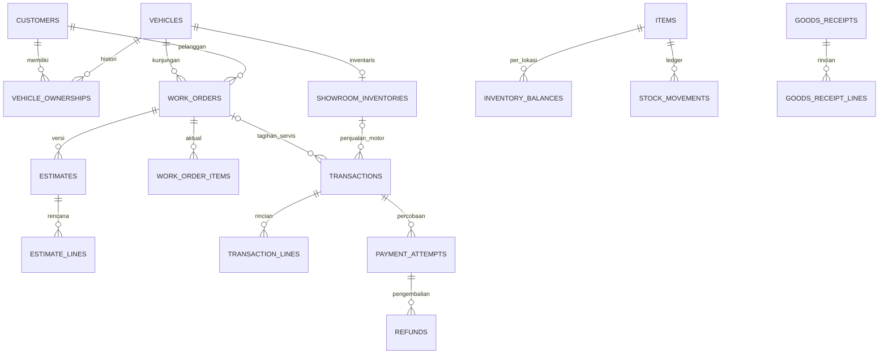

# Skema MySQL dan Aturan Integritas

Status: desain dan implementasi database development lokal, 8 November 2026. Sebanyak 42 tabel bisnis/pendukung dan journal migration sudah dibuat pada MySQL 8.4.13. Alokasi KOR dan action bisnis tetap belum aktif. Acuan utama: PRD v1.2 bagian 10–14, 16, 19–20, dan 25. Definisi kolom: [data dictionary](DATA_DICTIONARY.md). Batas keamanan aktual: [panduan MySQL lokal](../../infra/mysql/README.md).

## 1. Keputusan dasar

- Satu database terpusat; MySQL Community 8.4 LTS, InnoDB, `utf8mb4`, collation teks `utf8mb4_0900_ai_ci`. Token/hash/reference eksternal memakai perbandingan biner agar case-sensitive.
- ID/FK `BIGINT UNSIGNED`; nilai uang `BIGINT` Rupiah nonnegatif; kuantitas dan WAC `DECIMAL(19,4)`. Tidak memakai float/double untuk uang atau modal.
- Simpan timestamp `DATETIME(6)` dalam UTC dan gunakan koneksi database UTC. Nomor dokumen dan batas hari/bulan laporan dihitung server dalam Asia/Jakarta lalu dikonversi ke UTC untuk query.
- Nama tabel/kolom `snake_case`; kode status bahasa Inggris; label UI Bahasa Indonesia.
- Foreign key memakai `ON DELETE RESTRICT` dan ID tidak diperbarui. Master dinonaktifkan; transaksi final, ledger, dan audit tidak dihapus oleh alur aplikasi. Penghapusan sesi kedaluwarsa dilakukan terpisah dari data bisnis.
- Constraint satu baris ditegakkan dengan FK, UNIQUE, dan CHECK. Validasi agregat, jumlah foto, lintas tabel, serta transisi status dijalankan oleh action Laravel dalam transaksi database. CHECK tidak dianggap sebagai validasi lintas tabel.
- Laravel menggunakan sesi database standar, bukan tabel token kustom dari ilustrasi ERD lama. Session inactivity/revocation dikelola backend; mekanik/PIC bukan akun login.

## 2. Pemetaan LRS ke aplikasi

| LRS awal | Model implementasi usulan | Requirement |
|---|---|---|
| PELANGGAN dan PEMBELI | Satu `customers`; pembeli adalah peran pelanggan pada transaksi. | CRM-01/02, SHR-09 |
| KENDARAAN dan MOTOR | Satu `vehicles`; informasi komersial di `showroom_inventories`. | DEC-08, SHR-02/17 |
| FK pelanggan di kendaraan | Histori `vehicle_ownerships`; referensi pelanggan pada WO tetap menjadi snapshot pihak yang dilayani. | Bagian 14, OQ-15 |
| UK nomor polisi | Index biasa; hanya rangka/mesin unik jika terisi. Kosong dinormalisasi NULL. | CRM-03 |
| NOTA_SERVIS | `work_orders`, versi `estimates`, `work_order_items`, lalu `transactions`/`transaction_lines`. | WKS-01 sampai WKS-15 |
| DETAIL_SERVIS | Pisahkan rencana estimasi, aktual pekerjaan, dan baris tagihan historis. | WKS-10/11/12 |
| PEGAWAI dan MEKANIK | `users` untuk pelaku aplikasi; `operational_staff` untuk mekanik/PIC. | DEC-04, MST-11 |
| PENJUALAN | `transactions` tipe `MOTOR`; referensi inventaris dan pelanggan. | SHR-09/10 |
| PEMBAYARAN 1:1 | Metode pelunasan tunggal dengan beberapa `payment_attempts`; dana berhasil dibatasi, retry gagal tetap tersimpan. | PAY-01/09/10, bagian 14.2 |

Pemetaan ini tidak mengedit halaman draw.io. Rekonsiliasi model aplikasi harus direview sebelum migration domain dibuat.

## 3. Kelompok tabel dan batas rilis

| Kelompok | Tabel P0/pendukung teknis |
|---|---|
| Akses | `roles`, `permissions`, `role_permissions`, `users`, `user_permissions`, `sessions` |
| Konfigurasi | `business_locations`, `business_settings`, `discount_policies`, `document_sequences` |
| Pelanggan/motor | `customers`, `vehicles`, `vehicle_ownerships` |
| Master operasional | `operational_staff`, `item_categories`, `units`, `items`, `suppliers`, `service_catalog` |
| Persediaan | `inventory_balances`, `goods_receipts`, `goods_receipt_lines`, `stock_adjustments`, `stock_adjustment_lines`, `stock_movements` |
| Bengkel | `work_orders`, `work_order_status_history`, `estimates`, `estimate_lines`, `work_order_items` |
| Showroom/media | `showroom_inventories`, `vehicle_photos` |
| Tagihan | `transactions`, `transaction_lines`, `discount_approvals` |
| Pembayaran | `payment_methods`, `payment_attempts`, `payment_gateway_events`, `refunds` |
| Koreksi, desain bersyarat | `payment_allocations`; pemakaian untuk KOR menunggu keputusan metode selisih |
| Kontrol teknis | `audit_logs`, `migration_batches`, `idempotency_keys` |

P1 tidak dimigrasikan sekarang: purchase request/approval, retur supplier/penjualan terstruktur, inquiry/follow-up, biaya tambahan motor, stock opname, receipt print log, dan read/unread notifikasi. Peringatan stok P0 dapat berasal dari query saldo/minimum, tanpa menunggu tabel notifikasi P1. Laporan/dashboard merupakan query/proyeksi dari tabel sumber, bukan tabel transaksi baru.

Diagram merangkum relasi historis, bukan seluruh constraint final. Draft dapat belum memiliki baris; dokumen final wajib memiliki detail. Satu WO/inventaris dapat memiliki histori transaksi batal/koreksi, tetapi hanya satu Final aktif.

## 4. Keunikan dan constraint MySQL

Generated column + UNIQUE menggantikan kebutuhan partial unique index. Kolom asli tetap menjadi FK; generated column hanya pendukung keunikan, bukan FK pengganti.

| Aturan | Bentuk constraint usulan |
|---|---|
| Satu kepemilikan aktif per motor | `active_vehicle_id = IF(valid_to IS NULL, vehicle_id, NULL)`; UNIQUE. |
| Satu transaksi Final aktif per WO | `final_work_order_id = IF(status = 'FINAL', work_order_id, NULL)`; UNIQUE. |
| Satu penjualan Final aktif per inventaris | `final_showroom_inventory_id = IF(status = 'FINAL', showroom_inventory_id, NULL)`; UNIQUE. |
| Satu dana berhasil per transaksi asal | `funded_transaction_id = IF(status IN ('PAID','REFUND_PENDING','REFUNDED'), transaction_id, NULL)`; UNIQUE. Pembayaran yang direfund tidak membuka peluang pembayaran kedua atas dokumen asal. |
| Satu versi estimasi | UNIQUE `(work_order_id, version)`. |
| Saldo per item/lokasi | PK `(item_id, location_id)`. |
| Nomor dokumen | UNIQUE `number` pada setiap tabel dokumen; counter atomik per tipe/periode. |
| Callback provider | UNIQUE `(provider, external_event_id)`; event ID tidak boleh NULL. Adapter harus menyediakan kunci deduplikasi stabil jika provider tidak memberi ID. |
| Posting ledger | UNIQUE `posting_key`; tidak mengandalkan tombol frontend. |
| Saldo awal tunggal | Generated `opening_item_id = IF(movement_type='OPENING', item_id, NULL)`; UNIQUE `(location_id,opening_item_id)` mencegah opening kedua dari file/batch berbeda. |
| Retry request API | UNIQUE `(user_id, operation, idempotency_key)` dan hash request; key yang sama dengan isi berbeda ditolak. |

Nama contoh generated column menjadi spesifikasi usulan untuk migration; ekspresinya diuji pada MySQL asli. CHECK menolak nilai negatif, versi < 1, rasio konversi <= 0, owner_type tanpa pasangan FK yang benar, dan baris dengan referensi jenis yang bertentangan. Constraint unik normalisasi rangka/mesin berada pada nilai yang telah dinormalisasi server; normalisasi tidak diterapkan ke external reference provider.

Nomor default mengikuti MST-08: `WO`, `SRV`, `POS`, `MTR`, `GR`, `RFD`, `ADJ`, `KOR`. Prefix `RTS` disiapkan saat retur supplier P1. Format `PREFIX-YYMM-NNNN`, batas counter 9999; jika habis, hentikan penerbitan dengan error operasional dan eskalasi, tidak memotong digit atau mendaur ulang nomor. Gap nomor akibat rollback yang aman tidak berarti nomor boleh dipakai ulang.

Histori kepemilikan membutuhkan `valid_to > valid_from` jika terisi. UNIQUE aktif tidak mencegah dua periode tertutup saling overlap: action mengunci baris `vehicles`, kemudian memeriksa seluruh interval terkait sebelum membuat/mengubah periode. Pergantian berikutnya menutup periode lama dan membuka periode baru pada satu timestamp UTC.

## 5. Status dan transisi

| Domain | Kode tersimpan → label Bahasa Indonesia |
|---|---|
| WO | `DRAFT` → Draft; `INSPECTION` → Inspeksi; `AWAITING_APPROVAL` → Menunggu Persetujuan; `AWAITING_PARTS` → Menunggu Barang; `IN_PROGRESS` → Dikerjakan; `READY_FOR_PICKUP` → Siap Diambil; `COMPLETED` → Selesai; `CANCELLED` → Dibatalkan |
| Estimasi | `PENDING` → Menunggu; `APPROVED` → Disetujui; `REJECTED` → Ditolak; `REVISED` → Direvisi |
| Inventaris showroom | `DRAFT`, `AVAILABLE`, `RESERVED`, `SOLD`, `ARCHIVED` |
| Transaksi | `DRAFT`, `AWAITING_PAYMENT`, `FINAL`, `CANCELLED` |
| Pembayaran | `PENDING`, `PAID`, `FAILED`, `EXPIRED`, `CANCELLED`, `REFUND_PENDING`, `REFUNDED` |
| Refund | `REFUND_PENDING`, `REFUNDED` |
| Penerimaan/adjustment | `DRAFT`, `FINAL`, `CANCELLED` |
| Approval diskon | `PENDING`, `APPROVED`, `REJECTED` |

- Transisi WO persis mengikuti PRD 13.1. `IN_PROGRESS` boleh kembali menunggu barang/persetujuan; pembatalan perlu rekonsiliasi barang. `READY_FOR_PICKUP` hanya ke `COMPLETED`; `COMPLETED`/`CANCELLED` terminal pada alur biasa.
- Status estimasi terpisah dari WO. Versi lama dipertahankan; persetujuan menyebut versi/nilai yang disetujui dan staf pencatat. Perubahan isi membatalkan approval diskon lama melalui pemeriksaan hash snapshot.
- Kenaikan dari estimasi disetujui melewati Rp50.000 atau 10% memerlukan persetujuan ulang; nilai awal configurable, penurunan tidak memicu persetujuan ulang (MST-13). Perbandingan batas menggunakan aritmetika desimal, bukan float; jika basis nol, kenaikan positif harus diminta persetujuan agar tidak membagi nol.
- `KOR` adalah document_type, bukan status atau kategori pendapatan. Kategori bisnis tetap `SERVICE`, `POS`, atau `MOTOR`.
- Event gateway tervalidasi dipetakan adapter ke state internal. Event lama tidak memundurkan dana yang sudah sah. Sukses terlambat setelah transaksi batal/tidak lagi dapat difinalisasi dicatat sebagai kebutuhan rekonsiliasi, bukan diabaikan atau memaksa penjualan ganda.

## 6. Batas transaksi database

Semua jalur memakai authorization backend dan audit dalam transaksi lokal yang sama. Urutan lock konsisten lintas action: dokumen transaksi terkait menurut ID; WO/vehicle/inventaris terkait menurut ID; payment/refund terkait menurut ID; saldo item menurut `(location_id,item_id)`; counter nomor sesuai kebutuhan. Action yang tidak memakai sebagian kelompok melewatinya, bukan membalik urutan. Pemeriksaan stok menggunakan locking read terbaru; deadlock diulang terbatas dengan key idempotensi yang sama, tanpa mengulang panggilan provider.

| Proses | Perubahan yang harus atomik |
|---|---|
| Penerimaan barang | Validasi status/rasio; lock saldo; simpan snapshot satuan/konversi/modal; buat movement masuk; perbarui saldo/WAC; finalisasi header; audit. Draft tidak memengaruhi stok. |
| Konfirmasi barang WO | Lock WO dan saldo; cek stok cukup; simpan aktual/snapshot WAC; buat movement keluar; perbarui saldo; audit. Barang non-stock dan jasa tidak menghasilkan movement. |
| Pembayaran/finalisasi servis | Lock transaksi/WO dan dana; cek estimasi/approval/foto/aktual; pastikan movement aktual sudah sah; simpan pembayaran manual atau pakai dana gateway sah; bekukan detail/nota; Final tanpa potong stok lagi. Serah terima terpisah menutup WO hanya jika transaksi Final. |
| Penjualan POS | Setelah pelunasan sah, lock saldo; snapshot harga/modal; movement keluar; saldo; transaksi Final; nota snapshot; audit. |
| Penjualan motor | Lock transaksi, vehicle, inventaris, dan dana; cek ketersediaan/reservasi/foto; verifikasi lunas; tutup ownership usaha; buka ownership pelanggan; inventaris SOLD; transaksi Final; audit. |
| Pembatalan biasa | Lock dokumen/sumber/dana; alasan wajib; reversal efek stok yang sah; pulihkan status/ownership yang masih konsisten; transaksi batal; buat Refund Pending jika dana diterima; audit. Tidak menghapus pembayaran asal. |
| Reversal barang WO | Lock WO/saldo; batasi kuantitas reversal kumulatif; posting arah berlawanan dengan biaya historis; saldo/WAC direkonsiliasi; audit. Pembatalan WO ditolak sampai seluruh barang direkonsiliasi. |
| Koreksi KOR | Desain saja: batalkan asal, reversal yang sah, buat draft KOR dengan tipe bisnis sama, lepas alokasi dana lama lalu alokasikan ke KOR. Tanpa refund otomatis atas dana yang dialihkan. Selisih memerlukan aturan bisnis yang belum diputuskan. |
| Penyelesaian refund | Lock pembayaran/refund/alokasi; metode sesuai asal; dana tidak teralokasi dan tidak melebihi sisa yang dapat direfund; simpan penerima, referensi, aktor, waktu; audit. |

Untuk pembatalan penjualan motor yang kepemilikannya sudah berubah lagi atau memiliki aktivitas lanjutan yang membuat rollback tidak aman, jangan menimpa histori: tolak jalur otomatis dan eskalasi ke owner untuk koreksi terkontrol. Pembatalan penerimaan juga tidak boleh menyebabkan stok/nilai persediaan tidak sah; tolak pembalikan otomatis yang tidak dapat direkonsiliasi.

WAC penerimaan memakai rumus BR-STK-08: `(qty_lama × WAC_lama + qty_masuk × biaya_masuk) / qty_baru`, dibulatkan half-up 4 desimal. Barang keluar memakai snapshot WAC saat posting. Reversal memakai biaya historis movement asal, dengan perhitungan saldo/modal konsisten dalam action; tidak mengganti biaya historis dengan master terbaru. Perilaku nilai sisa yang tidak sah memerlukan rekonsiliasi owner, bukan modal negatif yang disembunyikan. Retur supplier beserta rumus pengecualiannya tetap P1.

Nominal baris dibulatkan half-up ke Rupiah, kemudian dijumlah. Simpan diskon per baris dan header secara terpisah agar tidak dihitung dua kali; total diskon = diskon baris + diskon header, dibandingkan ke subtotal sebelum diskon. Approval terikat hash isi/harga/kuantitas/diskon yang akan difinalisasi. Harga satuan hanya ditentukan server dari master/snapshot; perubahan master tidak mengubah histori final.

Panggilan jaringan ke gateway, upload objek, dan render PDF tidak berada di dalam transaksi InnoDB. Simpan request pembayaran dengan referensi unik, panggil provider secara idempotent setelah commit, lalu simpan hasil; callback boleh datang lebih dulu dan wajib dapat direkonsiliasi. Verifikasi signature terhadap payload asli sebelum memasukkan event ke tabel deduplikasi; signature tidak sah hanya dicatat pada log teknis tersanitasi dan tidak boleh memesan event ID yang dapat dipakai callback sah. Simpan event webhook terverifikasi dan terdeduplikasi dahulu, proses dengan job yang dapat diulang, dan finalisasi lokal satu kali. Worker harus dapat menemukan event belum diproses setelah crash.

Dana gateway yang nyata sudah masuk tetap harus dicatat meskipun stok/motor sudah tidak dapat dijual saat callback tiba. Jangan membatalkan fakta penerimaan hanya karena finalisasi bisnis ditolak: simpan event untuk rekonsiliasi dan tangani refund melalui proses owner. Unique constraint transaksi lokal tidak mencegah dua pembayaran eksternal; pembuatan retry harus memeriksa status provider terakhir dan menjaga hanya satu request pembayaran aktif sesuai kebijakan adapter.

Nota secara logis diterbitkan dengan nomor dan snapshot pada commit finalisasi. Render/cetak PDF setelah commit dapat diulang dari snapshot yang sama tanpa pembayaran atau movement baru. File foto diunggah ke area privat, divalidasi, lalu metadata ditautkan; objek yatim dibersihkan hanya menurut kebijakan storage/retensi yang disepakati.

## 7. Dana koreksi dan keputusan terbuka

`payment_attempts.transaction_id` tetap menunjuk transaksi asal penerimaan uang. `payment_allocations` memetakan dana ke dokumen yang dilunasi dan merekam pelepasan alokasi tanpa mengubah asal pembayaran. Pembayaran gagal tidak memiliki alokasi dana aktif.

Invariant yang dirancang: per pembayaran, alokasi aktif + refund Pending/Refunded tidak boleh melampaui penerimaan bersih (`amount_received - change_amount`). Final membutuhkan alokasi dana sah senilai total. Nilai refund yang masih Pending tidak boleh dipakai lagi.

PRD BR-013 mengizinkan dana lama + pembayaran selisih, sedangkan 14.2 membatasi satu Paid per transaksi. Usulan teknis: batas satu dana berhasil berlaku per dokumen asal penerimaan; KOR memakai alokasi dari asal. **Penafsiran ini belum menjadi keputusan owner**, demikian pula metode selisih. Jangan membuat constraint/proses yang menganggap KOR pasti boleh split payment. Tabel alokasi dan alur koreksi direview sebelum migration pembayaran; fitur KOR tetap belum aktif. Draft dengan total nol dan status lunas tanpa penerimaan juga perlu klarifikasi sebelum implementasi finalisasi karena bertemu aturan pembayaran penuh dan diskon; tidak memilih metode finansial sendiri.

## 8. Index awal dan akses sensitif

- Pelanggan: `name`, `contact`; kendaraan: `license_plate`, `(brand, model)`, UQ rangka/mesin. Pencarian substring tidak dijanjikan cepat hanya karena B-tree: ukur query aktual, pilih prefix search dan pagination lebih dulu.
- WO: `(location_id,status,received_at)`, `(vehicle_id,received_at)`, `(operational_staff_id,status)`.
- Inventaris: `(location_id,status)`, kode unik; harga/tahun ditambahkan jika pola query membutuhkannya.
- Transaksi: `(location_id,status,transaction_at)`, `(transaction_type,status,transaction_at)`, `(created_by,transaction_at)`.
- Ledger: `(item_id,location_id,occurred_at,id)` untuk kartu stok dengan urutan stabil.
- Pembayaran: `(status,requested_at)`, `(transaction_id,status)`, UQ internal reference dan provider/reference; event `(processing_status,received_at)`.
- Audit: `(occurred_at,id)`, `(actor_id,occurred_at)`, `(module,action,occurred_at)`, `document_number`.
- Query laporan memakai rentang UTC `[awal, akhir)` dari tanggal Jakarta; tidak membungkus kolom index dengan fungsi tanggal pada filter utama.

Permission membatasi serializer/API dan query domain/pengguna/hari sesuai PRD 10.2; index bukan kontrol akses. Password hanya hash; secret gateway di environment/secret store, bukan business_settings. Audit dan payload tersanitasi; IP/kontak tidak disalin berlebihan. File gambar tidak dimasukkan sebagai BLOB: simpan object_key privat, MIME/ukuran/jenis foto, dan aktor.

## 9. Urutan migration dan seed

1. Fondasi: roles/permissions/pivot/users/sessions, lokasi, settings, discount policy, counter, audit, idempotency.
2. Pelanggan/motor: customers, vehicles, ownership; FK sumber transaksi di ownership ditambahkan setelah transactions ada.
3. Master: kategori, satuan, item, supplier, jasa, operational staff, payment methods, migration batches, saldo.
4. Sumber dokumen: penerimaan/detail, WO/histori/estimasi/aktual, inventaris showroom/foto, adjustment/detail.
5. Tagihan: transactions/detail, approval diskon, kemudian lengkapi FK silang. FK transaksi sumber pada ownership tidak boleh dibiarkan tanpa constraint setelah tahap ini.
6. Ledger: movements merujuk sumber yang sudah ada. Relasi balik WO item ke movement dihitung dari sumber movement, tidak menyimpan FK dua arah yang berputar.
7. Pembayaran/event/refund; alokasi setelah keputusan KOR dikunci. Tabel jobs/failed_jobs/cache hanya jika dipilih framework.

Seed awal: empat role PRD; seluruh permission minimum bagian 10.2; satu lokasi; IDR/Asia-Jakarta; batas diskon 0%; ambang estimasi Rp50.000/10%; metode tunai/transfer aktif. QRIS/e-wallet hanya aktif setelah provider dikonfigurasi. Batas sesi inactivity usulan 30 menit, configurable dan perlu validasi operasional sebelum pilot. Owner dibuat dengan password input administratif, tidak ditanam di repository.

Data awal impor: aktif saja, opening balance dan WAC awal, motor/pelanggan relevan, serta WO berjalan. Setiap opening movement menaut migration_batch. Hash sumber, referensi baris dan kunci impor mencegah pengulangan saldo awal. Validasi seluruh batch dulu; baris salah dilaporkan sebelum posting, tanpa saldo parsial yang tidak jelas. Histori sebelum cutover tidak direkayasa menjadi pendapatan aplikasi.

## 10. Rencana pengujian dan penerimaan

Pengujian constraint, permission SQL, TLS, concurrency tingkat database, dan backup/restore sudah dijalankan pada MySQL asli; lihat [hasil aktual](verification-results.json). Matriks berikut tetap target penerimaan domain: bagian yang membutuhkan backend/API, provider, dan perhitungan bisnis belum dianggap lulus hanya karena skemanya ada.

| Skenario | Hasil yang harus dibuktikan | PRD/UAT |
|---|---|---|
| FK dan nilai invalid | Referensi asing, rasio <=0, dan saldo negatif ditolak. | NFR-REL-03, UAT-05 |
| Kepemilikan simultan | Dua ownership aktif ditolak; interval tertutup tidak overlap. | DEC-08, UAT-18 |
| Identitas motor | Polisi sama diperbolehkan dengan warning; rangka/mesin sama ditolak; kosong menjadi NULL. | CRM-03 |
| Konversi dan WAC | 1 dus × 24 menjadi 24 satuan dasar; WAC berubah benar; snapshot lama tetap. | UAT-09/27/30 |
| Dua pemakaian stok sisa 1 | Hanya satu berhasil; rollback tidak meninggalkan movement parsial. | UAT-26 |
| Pembayaran servis setelah pemakaian | Tidak ada movement keluar kedua. | UAT-04 |
| Dua penjualan motor | Hanya satu Final; status/ownership konsisten. | SHR-10/11, NFR-REL-08 |
| Nomor dan request bersamaan | Tidak ada nomor/finalisasi ganda; request yang sama mengembalikan hasil yang sama. | MST-08, NFR-REL-02/08 |
| Callback duplikat/tidak berurutan | Satu dana/finalisasi; event lama tidak memundurkan status; sukses terlambat direkonsiliasi. | UAT-16/17 |
| Diskon dan perubahan estimasi | Approval di atas batas wajib; perubahan isi membatalkan approval lama. | UAT-15/19 |
| Reversal dan refund | Pembalikan mengikuti biaya historis; kumulatif refund/reversal tidak melebihi asal. | UAT-08/23/24/28 |
| Crash setelah commit | Job event/PDF dapat diulang tanpa posting atau pembayaran baru. | NFR-REL-01/02 |
| Hak akses dan laporan | Modal tidak bocor; staf hanya melihat cakupan domain/pengguna/hari yang diizinkan. | UAT-01/11/31 |
| Opening dan pemulihan | Impor ulang tidak menggandakan saldo; restore mengembalikan metadata, ledger, dan sumber yang konsisten. | UAT-20, NFR-BCK-03 |
| Koreksi KOR | Ditambahkan setelah keputusan metode/alokasi; belum dinyatakan lulus. | UAT-25 |

Sebelum go-live: daily backup DB/metadata dan proteksi foto dipilih sesuai fasilitas; restore diuji; pemilik akun/biaya ditetapkan; seluruh P0 memiliki bukti uji atau exception stakeholder. Dokumen ini tidak menjamin target availability hosting gratis.

## Referensi teknis

- [MySQL 8.4: index generated column](https://dev.mysql.com/doc/refman/8.4/en/create-table-secondary-indexes.html).
- [MySQL 8.4: locking reads](https://dev.mysql.com/doc/refman/8.4/en/innodb-locking-reads.html).
- [MySQL 8.4: CHECK constraints](https://dev.mysql.com/doc/refman/8.4/en/create-table-check-constraints.html).
